  
  
  
  
  

## Hi there

I'm **Julio Azancort**, a software developer at **Pmweb** based in Belém, Brazil, building production web applications with **Vue 3**, **TypeScript/JavaScript**, **FastAPI**, and **PostgreSQL**.

Alongside software engineering, I conduct AI and Operations Research studies at the **Federal University of Pará (UFPA)**, focusing on recursive LLM fine-tuning on synthetic data (model collapse), parameter-efficient adaptation (`LoRA`/`QLoRA`), AI governance, and multi-objective evolutionary optimization (`NSGA-II`).

---

## Featured Research & Open Source

| Project | Focus |
|---|---|
| [**llm-knowledge-collapse-experiments**](https://github.com/Jazancort/llm-knowledge-collapse-experiments) | Dose-response experiments across 3 LLM backbones, 10 recursive generations, rank/LR ablations, and exposure interventions |
| [**llm-knowledge-collapse-replication**](https://github.com/Jazancort/llm-knowledge-collapse-replication) | Reproducible replication package for *Effective Training Pressure Gates Recursive Knowledge Degradation in LLMs* |
| [**cosrev-recursive-training-replication**](https://github.com/Jazancort/cosrev-recursive-training-replication) | Supplementary materials, theorem cards, and verification scripts for *Recursive Training on Model-Generated Data* |
| [**NSGA2-GIS-Landfill-Optimization-Cape-Verde**](https://github.com/Jazancort/NSGA2-GIS-Landfill-Optimization-Cape-Verde) | Multi-objective GIS + NSGA-II spatial optimization with exhaustive Pareto validation ([Zenodo](https://doi.org/10.5281/zenodo.17704387)) |
| [**mcdm-landfill-pareto-paper**](https://github.com/Jazancort/mcdm-landfill-pareto-paper) | Replication package analyzing normalization as implicit re-weighting in multi-criteria portfolio selection |

---

## Toolbox

  

---

## GitHub Activity & Metrics

  
   
  
   
  

---

  <a href="https://www.linkedin.com/in/jazancort">LinkedIn</a> ·
  <a href="https://orcid.org/0000-0003-2866-5445">ORCID</a> ·
  <a href="http://lattes.cnpq.br/4326084606086081">Lattes</a> ·
  <a href="https://github.com/Jazancort">GitHub</a>

